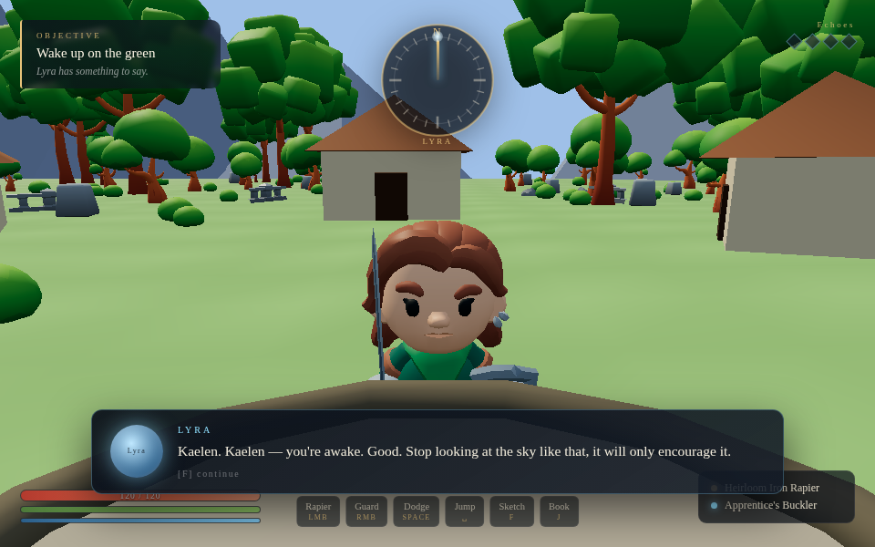

# Echoes of the Sunken Spire

A low-poly action-adventure, shipped three ways from one codebase: a **browser
game**, a **single-file offline HTML**, and a **native Windows executable** with
no engine behind it.



You wake on the green as Kaelen, with a rapier, a buckler, and a bell to ring.
Climb the Spire, light the way, and find out what is singing underneath it.

---

## What is in here

| path | what it is |
|---|---|
| `web/` | the browser game (three.js + Vite). This is the source of truth for gameplay |
| `native/` | a from-scratch C++17 port: software rasterizer, glTF/GLB loader, X11 + Win32 back ends |
| `standalone/` | packs the web build into one self-contained `.html` |
| `builds/` | build output (git-ignored) |
| `docs/screenshots/` | screenshots used in this README |

The two implementations share the art and the design, not the code: the native
port reimplements movement, OoT-style combat, lock-on, enemies, dialogue and the
HUD in C++ against the same KayKit models.

## Play it

### Browser

```bash
cd web
npm install
npm run dev        # http://localhost:5173
```

### One file, offline

```bash
cd standalone
./make.sh
# -> builds/Echoes-of-the-Sunken-Spire-standalone.html        (all assets, ~28 MB)
# -> builds/Echoes-of-the-Sunken-Spire-standalone-light.html  (used only, ~16 MB)
```

Open the HTML by double-clicking it. Every script, font, model and texture is
inlined — including the textures embedded inside the GLBs, rewritten to `data:`
URIs so they survive sandboxed iframes and strict CSP. No server, no network.

Verify a build with:

```bash
node standalone/verify.mjs builds/Echoes-of-the-Sunken-Spire-standalone.html \
     web/public --expect-all
```

### Native Windows executable

```bash
cd native
./build_exe.sh      # -> builds/Echoes-of-the-Sunken-Spire.exe  (~20 MB)
```

Needs `g++-mingw-w64-x86-64` and `binutils-mingw-w64-x86-64`. The whole
`web/public/assets` tree is baked into the executable, so it needs no folder
beside it — copy it anywhere and double-click.

Or build the native code for Linux/Windows directly:

```bash
cd native
make                            # -> ./spire  (reads assets from disk)
./spire --data ../web/public/assets
```

```bat
build.bat                       :: MSVC, from an x64 Native Tools prompt
```

#### About the Windows warnings

The executable is **unsigned**, so Windows will complain the first time:

* **"Windows protected your PC"** → *More info* → **Run anyway**.
* File blocked → right-click → *Properties* → tick **Unblock** → *Apply*.
* Launching it from a command prompt skips SmartScreen entirely (it only
  filters Explorer/double-click launches).

The manifest declares `asInvoker`, so it never asks for administrator rights.

## Controls

| | |
|---|---|
| **WASD** move | **Shift** sprint |
| **LMB** attack (combo) | **RMB** block |
| **Space** dodge / jump | **Q** bolt |
| **E** elixir | **F** interact |
| **Tab / MMB** lock on | **Esc** pause |
| **Mouse** camera | |

Xbox-compatible controllers work alongside the keyboard: left stick move, right
stick camera, A dodge, X attack, B interact, Start pause.

## How the native renderer works

No SDL, no OpenGL, no engine — a hand-written software rasterizer in
`native/src/`:

```
base.h        math, JSON, inflate (RFC 1950/1951), PNG decode, mip chain
gltf.*        glTF 2.0 / GLB loader: meshes, materials, embedded textures, skins, clips
render.*      multithreaded rasterizer, bilinear + trilinear sampling, frustum culling, HUD
platform.*    one file, three back ends: X11, Win32/XInput, headless
game.*        movement, OoT-style combat, lock-on, enemies, dialogue
worlds.cpp    the campaign, assembled from the KayKit packs
vfs.*         asset lookup for the embedded single-file build
```

Because it is fill-rate bound, the internal resolution adapts: 1:1 with the
window when the machine can hold the frame rate, stepping down rather than
stuttering if it cannot.

## Credits

Game code: this repository.

3D art: **[Kay Lousberg / KayKit](https://kaylousberg.itch.io)** — Adventurers,
Skeletons, Dungeon, Forest, Character Animations and Fantasy Weapons Bits, all
released **CC0**. Full licence texts are in `web/public/assets/licenses/`.

## Licence

Game code and documentation: **MIT** (see `LICENSE`).
Art assets: **CC0**, courtesy of Kay Lousberg — they remain under CC0, not MIT.
